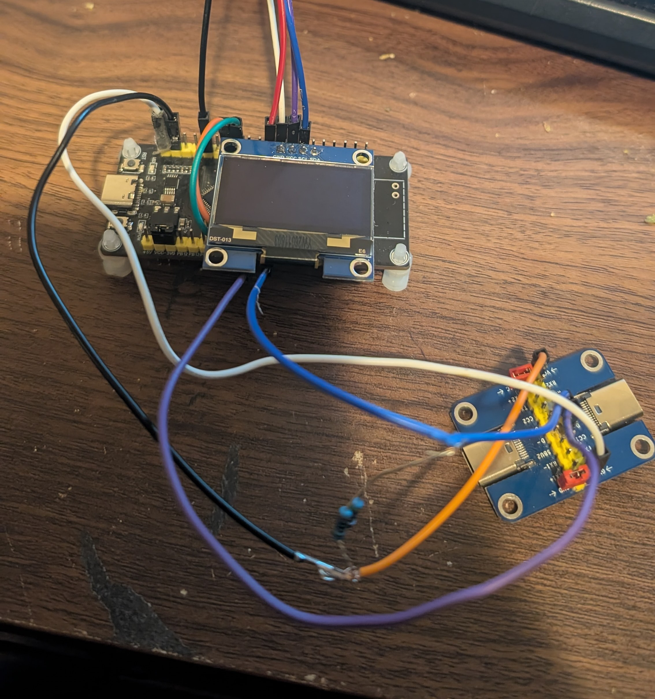

<p align="center">
  
  
</p>

# PJ26 USB-Serial Adapter(untested)

Firmware that turns a **DX-SMART PJ26** (STM32F103C8T6) into a 3.3 V **USB-to-serial adapter** with automatic ESP32 boot-mode control and an optional 1.3" OLED status screen. It was written to flash an **ESP32-CAM**, but it works as a general 3.3 V serial adapter.

The board shows up on the PC as a standard USB serial port (CDC-ACM). It uses the STM32's own USB pins, not the on-board CH340, and only these pins: **PA2, PA3, PA4, PA5, PA11, PA12, PB0, PB1, PB11, 3V3**.

> **Status:** the USB request handling is host tested (19 checks). The USB register code and the OLED driver compile but have **not been run on a board**. Expect to debug on first plug-in.

## Contents
- [What it does](#what-it-does)
- [Pins](#pins)
- [Wiring](#wiring)
- [Compile](#compile)
- [Flash the adapter](#flash-the-adapter)
- [Uses](#uses)
- [OLED status screen](#oled-status-screen)
- [Limits](#limits)
- [Troubleshooting](#troubleshooting)
- [Files](#files)

## What it does
- Presents a USB serial port to the PC. Baud rate, DTR and RTS follow whatever program opens the port.
- Copies bytes both ways between the PC and USART2 (PA2 TX, PA3 RX).
- **DTR and RTS drive the ESP32 boot pins** with the classic auto-program truth table (what esptool and the Arduino IDE expect):

| PC lines | PA4 (cam GPIO0) | PA5 (cam reset) |
|---|---|---|
| DTR only | pulled LOW (boot loader) | released |
| RTS only | released | pulled LOW (reset) |
| both or neither | released | released |

- Blue LED lights while data passes. The OLED shows the live state.

## Pins
| Pin | Function | Direction | Notes |
|---|---|---|---|
| PA11 | USB D- | PC <-> board | To the USB cable's D- (white or green wire) |
| PA12 | USB D+ | PC <-> board | To D+, **plus a 1.5 kΩ resistor to 3V3**: this "I am present" pull-up is what makes the PC detect the device |
| PA2 | USART2 TX | out | To the target's RX (ESP32-CAM U0R, GPIO3) |
| PA3 | USART2 RX | in | From the target's TX (ESP32-CAM U0T, GPIO1). 3.3 V only |
| PA4 | Boot control | open-drain out | To ESP32 GPIO0. Low = boot loader. Never driven high |
| PA5 | Reset control | open-drain out | To the ESP32 EN/reset pad (optional wire). Low = reset |
| PB0 | OLED SCL | open-drain out | Bit-banged I2C. The module's own pull-ups are used |
| PB1 | OLED SDA | open-drain I/O | |
| PB11 | Status LED | out | The PJ26's blue LED, active high |
| 3V3 | OLED power | | OLED VCC |
| GND | Ground | | Common with the target, the OLED and the USB cable |

PA2-PA5 and PB0/PB1 are **not 5 V tolerant**: never connect a 5 V signal to them.

## Wiring
```
 USB cable                 PJ26 (adapter)                 ESP32-CAM
 D-  ------------------->  PA11
 D+  ---+--------------->  PA12
        |
      1.5k to 3V3
 GND ------------------->  GND  ---------------------->  GND
                           PA2  ---------------------->  U0R (GPIO3)
                           PA3  <----------------------  U0T (GPIO1)
                           PA4  ---------------------->  GPIO0
                           PA5  ---------------------->  reset button pad (optional)
                                                         5V  <- 5 V supply
 OLED:  VCC=3V3   GND   SCL=PB0   SDA=PB1
```
- **Power the adapter** from its own USB-C (the CH340 is not used and the board still gets 5 V), or feed 5 V into its 5V pad from the data cable.
- **Power the ESP32-CAM** from a 5 V source of its own with a common ground. Its Wi-Fi bursts exceed what the PJ26's 3.3 V regulator can give.
- The AI-Thinker ESP32-CAM has no EN pin on its headers. For fully automatic upload, solder a wire from PA5 to one pad of the cam's reset button (the other pad is ground). Without it, hold GPIO0 low yourself (PA4 does that while DTR is asserted) and press the reset button by hand when the upload starts.

## Compile
Requires `clang`, `ld.lld` and `llvm-objcopy` (built here with LLVM 18). No STM32 libraries, HAL or CubeIDE needed.

```
./build.sh
```
This produces `pj26_usb_native.elf`, `.bin` and `.hex` (about 6 KB). Environment overrides: `CC`, `LD`, `OBJCOPY`.

Windows: use WSL or an LLVM install and run the commands in `build.sh` by hand.

Alternative with the Arm GNU toolchain (not tried here):
```
arm-none-eabi-gcc -mcpu=cortex-m3 -mthumb -Os -ffreestanding -nostdlib -fno-builtin -Wl,-T,link.ld \
    start.c main.c usb_proto.c oled.c -o pj26_usb_native.elf
arm-none-eabi-objcopy -O binary pj26_usb_native.elf pj26_usb_native.bin
```

Check the USB protocol logic on a PC (no hardware needed):
```
gcc -Wall -o usb_test usb_test.c usb_proto.c && ./usb_test     # 19 checks
```

## Flash the adapter
Flash the `.bin` at address **0x08000000** with an ST-Link on the SWD pads (3V3, GND, PA13 SWDIO, PA14 SWCLK):
- STM32CubeProgrammer: open the file, set the address 0x08000000, Download.
- `st-flash write pj26_usb_native.bin 0x8000000`
- or flash the `.hex` file, which carries its own address.

PA13/PA14 are not used by this firmware, so the ST-Link keeps working.

## Uses
**1. Flash an ESP32-CAM from the Arduino IDE.** Board *AI Thinker ESP32-CAM*, choose the new COM port, set Upload Speed to 460800 or lower (921600 is too fast for this polled adapter), press Upload. With the PA5 reset wire it is hands-off. Without it, press the cam's reset when the IDE says "Connecting...". Afterwards press reset again to run the sketch.

**2. Flash with esptool.**
```
esptool.py --chip esp32 --port COM5 --baud 460800 write_flash 0x10000 firmware.bin
```
(use `/dev/ttyACM0` on Linux). The adapter's DTR/RTS mapping matches esptool's default reset sequence.

**3. Talk to the cam by hand.** Open a terminal on the port at 115200 8N1, line ending CR+LF, and type AT commands (for example `AT`, `AT+CWLAP`, `AT+SDINFO`). Useful for debugging the Staplez Studio OS cam link without the main board.

**4. Listen in on a link.** Connect only GND and PA3 to a 3.3 V serial line (leave PA2 unconnected) to watch its traffic on the PC, for example the main board's UART2 link to the cam.

**5. General 3.3 V serial console** for any 3.3 V UART device (ESP modules, GPS, sensors, other microcontrollers' debug ports). 8N1 only, see [Limits](#limits).

## OLED status screen
A 1.3" **SH1106 128x64 I2C** module (address 0x3C) on PB0/PB1 is optional. If none answers at start-up the firmware skips it. It shows:

```
PJ26 USB-SERIAL
USB: READY          (WAITING FOR PC / CONNECTING / READY / PORT OPEN)
BAUD: 115200
DTR:0 RTS:0
IO0:HIGH EN:RUN     (IO0:LOW, EN:RESET while the PC asks for boot or reset)
PC>CAM 12345        bytes sent from the PC
CAM>PC 6789         bytes received from the target
TX:PA2 RX:PA3
```
The screen is redrawn one page at a time so USB service is never held up for long.

## Limits
- 8 data bits, no parity, 1 stop bit only. Parity and data-bit settings from the PC are ignored. This rules out the STM32 ROM boot loader (it needs even parity).
- No hardware flow control, no break signal.
- The adapter polls and has no DMA, so keep the baud at or below 460800.
- 3.3 V logic only.
- Needs the 1.5 kΩ resistor on PA12 and an 8 MHz crystal (the PJ26 has one). There is no internal-oscillator fallback, because USB needs an accurate clock.

## Troubleshooting
| Symptom | Check |
|---|---|
| PC does not see any new device | 1.5 kΩ from PA12 to 3V3; D+ and D- not swapped; a data cable (not charge-only); the crystal oscillates |
| "Unknown device" / no COM port on old Windows | Windows 10 and later load the serial driver automatically; Windows 7/8 need a CDC driver |
| Port appears but upload fails at "Connecting..." | TX/RX crossed (PA2 to U0R, PA3 to U0T); common ground; hold GPIO0 low and press reset by hand if PA5 is not wired |
| Garbage characters | Baud mismatch, or the target is not at the speed you selected |
| Cam resets during upload | Cam not on its own 5 V supply; add 470-1000 µF at its 5 V pin |
| OLED stays blank | Address 0x3C, SCL on PB0, SDA on PB1, 3V3 power. Shifted picture: the SH1106 needs a 2-column offset, already applied |

## Files
| File | Purpose |
|---|---|
| `main.c` | clock, pins, USB endpoint handling, byte pumping, status screen text |
| `usb_proto.c/.h` | USB descriptors, control requests, DTR/RTS to ESP pin mapping (hardware independent, tested on a PC) |
| `oled.c/.h`, `font5x7.h` | SH1106 text driver |
| `start.c`, `link.ld` | vector table, reset handler, linker script (64 KB flash, 20 KB RAM) |
| `build.sh` | build script |
| `usb_test.c` | PC test of the protocol layer |
| `pj26_usb_native.bin/.hex` | prebuilt firmware |

The USB IDs are VID 0x1209 / PID 0x0001 (the pid.codes test pair): fine for personal use, not for a product.
